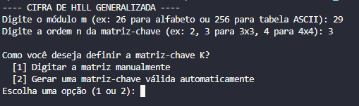
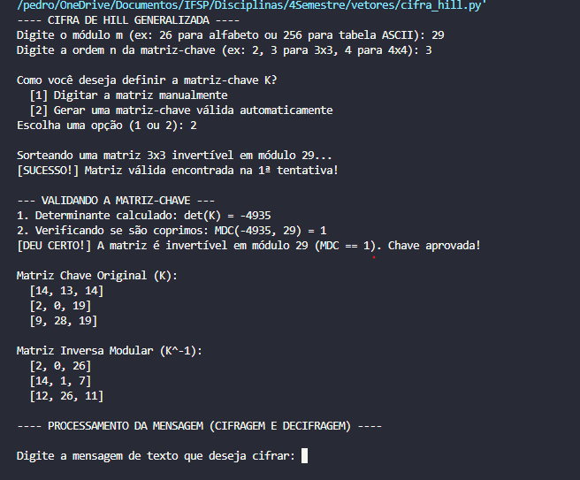
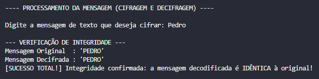
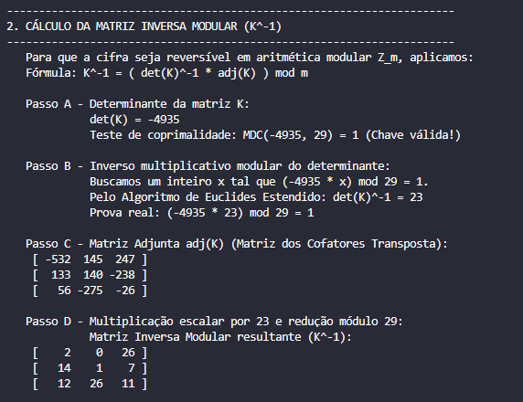
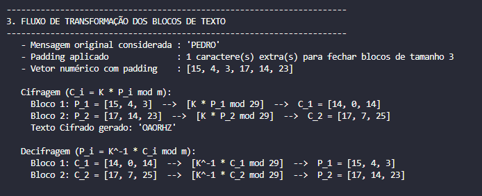
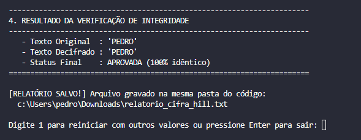

# Criptografia-Avançada-com-Matrizes-Cifra-de-Hill-Generalizada-
Aplicação desenvolvida em Python da Cifra de Hill generalizada para matrizes n x n sem bibliotecas matemáticas externas, com gerador automático de chaves invertíveis e relatório técnico em .txt.

O programa em questão faz parte de um projeto final da disciplina de Vetores, Geometria Analitica e Algebra Linear lecionada para o curso de BSI (Bacharelado de Sistemas de Informação).

## 📋 Índices 
- <a href="#funcionalidades"> Funcionalidades </a>
- <a href="#demonstracao"> Demonstração </a>
- <a href="#tecnologias"> Tecnologias Utilizadas </a>
- <a href="#utilidades"> Utilizades do Programa </a>

## 💻 Funcionalidades: 
- ✅ Generalização para matrizes de qualquer ordem (n x n) e módulos (26, 29 e 256);
- ✅ Álgebra linear e aritmética modular em Python;
- ✅ Validação matemática e gerador automático de chaves invertíveis;
- ✅ Padding automático e verificação de integridade da mensagem;
- ✅ Geração automática de relatório técnico completo em .txt.

## 👨🏽‍💻 Demonstração: 
Definição do valor do modulo (m) e ordem (n)

.
.
Definição da matriz manualmente, onde o usuário irá definir os valores:

Definição da matriz automaticamente, onde o programa irá gerar a matriz:

Resultado da CIFRAGEM e DECIFRAGEM:

.
RELATORIO TÉCNICO:

.
FIM:

Um software executado em um ambiente de terminal.

OBS: Após o fim do programa, um relatório em txt seja criado e disponibilizado na mesma pasta que está o arquivo cifra_hill.py

## 🛠 Tecnologias Utilizadas: 
- [Python](https://www.python.org/) - Linguagem de programação utilizada;

## 📌 Utilidades do Programa: 
- ✅ O programa é capaz de cifrar e decifrar mensagens de texto com segurança usando matrizes-chave de qualquer ordem ($n \times n$) e diferentes conjuntos de caracteres (alfabeto padrão, estendido ou tabela ASCII completa);

- ✅ O sistema pode ser usado como ferramenta didática no ensino de Álgebra Linear e Criptografia, demonstrando na prática conceitos como determinantes, matriz adjunta, inverso modular e aritmética no anel $\mathbb{Z}_m$;

- ✅ Pode ser utilizado para validar ou gerar chaves criptográficas invertíveis automaticamente, agilizando testes e simulações sem depender de bibliotecas matemáticas externas;

- ✅ Integrado a rotinas de estudo ou auditoria de algoritmos, o programa documenta automaticamente todo o processo matemático e o fluxo dos blocos em um relatório técnico (`.txt`), comprovando a integridade da mensagem recuperada;

- ✅ O sistema apresenta automatizações de tarefas, onde o sistema por si próprio realiza a tal atividade por comando de voz.

