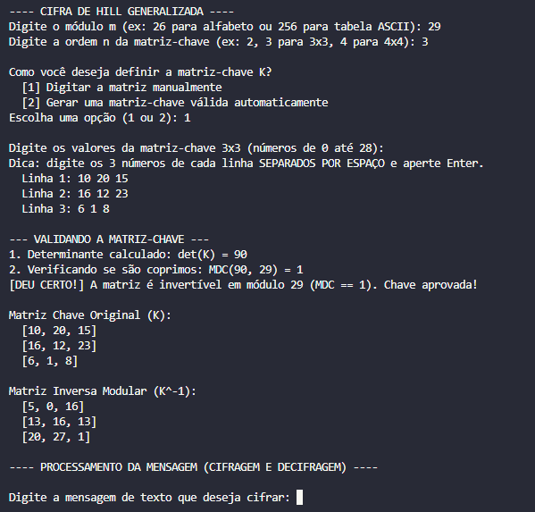
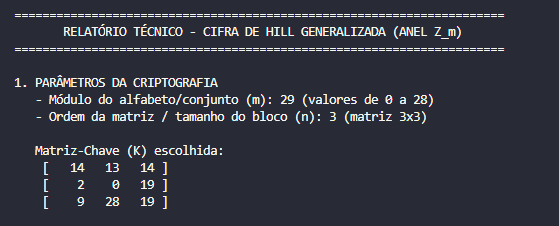

# Criptografia-Avançada-com-Matrizes-Cifra-de-Hill-Generalizada-
Aplicação desenvolvida em Python da Cifra de Hill generalizada para matrizes n x n sem bibliotecas matemáticas externas, com gerador automático de chaves invertíveis e relatório técnico em .txt.

O programa em questão faz parte de um projeto final da disciplina de Vetores, Geometria Analitica e Algebra Linear lecionada para o curso de BSI (Bacharelado de Sistemas de Informação).

## 📋 Índices 
- <a href="#funcionalidades"> Funcionalidades </a>
- <a href="#demonstracao"> Demonstração </a>
- <a href="#tecnologias"> Tecnologias Utilizadas </a>
- <a href="#utilidades"> Utilizades do Programa </a>

## 💻 Funcionalidades: 
- ✅ Generalização para matrizes de qualquer ordem (n x n) e módulos (26, 29 e 256);
- ✅ Álgebra linear e aritmética modular em Python;
- ✅ Validação matemática e gerador automático de chaves invertíveis;
- ✅ Padding automático e verificação de integridade da mensagem;
- ✅ Geração automática de relatório técnico completo em .txt.

## 🚀 Passo a Passo de Uso (Interação no Terminal): 

Ao executar o arquivo `cifra_hill.py`, o programa guia o usuário de forma interativa pelo terminal seguindo as etapas abaixo:

1. **Definição do Módulo ($m$):**
   - O usuário digita um número inteiro ($m \ge 2$) que define o conjunto de caracteres (anel $\mathbb{Z}_m$).
   - *Exemplos:* `26` para o alfabeto padrão (`A-Z`), `29` para o alfabeto estendido (`A-Z`, espaço, `.` e `?`) ou `256` para a tabela ASCII completa.

2. **Definição da Ordem da Matriz ($n$):**
   - O usuário informa o tamanho $n$ da matriz quadrada ($n \times n$) e dos blocos de texto (limitado entre `1` e `6` para manter o desempenho do cálculo manual de determinantes).
   - *Exemplos:* `2` para matrizes $2 \times 2$, `3` para $3 \times 3$, etc.

3. **Escolha da Matriz-Chave ($K$):**
   - O programa exibe um menu com duas opções:
     - **`[1]` Digitar manualmente:** O usuário insere os $n$ números de cada linha separados por espaço (ex: `3 3 2` e aperta Enter). O sistema valida na hora se $\det(K) \neq 0$ e $\text{MDC}(\det(K), m) = 1$; se não for invertível, pede uma nova matriz.
     - **`[2]` Gerar automaticamente:** O sistema sorteia matrizes aleatórias até encontrar uma que seja matematicamente invertível em $\mathbb{Z}_m$.

4. **Visualização das Matrizes ($K$ e $K^{-1}$):**
   - Com a chave aprovada, o programa exibe no terminal a Matriz-Chave original ($K$) e a sua Matriz Inversa Modular ($K^{-1}$) já calculada.

5. **Inserção da Mensagem de Texto:**
   - O usuário digita a frase ou palavra que deseja criptografar.
   - O sistema converte os caracteres para números, aplica o *padding* automático (completando com `'X'` caso o tamanho não feche blocos exatos de tamanho $n$), cifra com $K$ e decifra com $K^{-1}$.

6. **Conferência, Relatório e Reinício:**
   - O terminal exibe a verificação de integridade (comparando o texto original com o decifrado) e o relatório técnico detalhado, além de salvar automaticamente o arquivo `relatorio_cifra_hill.txt` na mesma pasta do script.
   - Por fim, o usuário pode digitar **`1`** para reiniciar com novos valores ou apenas pressionar **`Enter`** para encerrar o programa.

## 👨🏽‍💻 Demonstração: 

Um software executado em um ambiente de terminal.

OBS: Após o fim do programa, um relatório em txt seja criado e disponibilizado na mesma pasta que está o arquivo cifra_hill.py

## 🛠 Tecnologias Utilizadas: 
- [Python](https://www.python.org/) - Linguagem de programação utilizada;

## 📌 Utilidades do Programa: 
- ✅ O programa é capaz de cifrar e decifrar mensagens de texto com segurança usando matrizes-chave de qualquer ordem ($n \times n$) e diferentes conjuntos de caracteres (alfabeto padrão, estendido ou tabela ASCII completa);

- ✅ O sistema pode ser usado como ferramenta didática no ensino de Álgebra Linear e Criptografia, demonstrando na prática conceitos como determinantes, matriz adjunta, inverso modular e aritmética no anel $\mathbb{Z}_m$;

- ✅ Pode ser utilizado para validar ou gerar chaves criptográficas invertíveis automaticamente, agilizando testes e simulações sem depender de bibliotecas matemáticas externas;

- ✅ Integrado a rotinas de estudo ou auditoria de algoritmos, o programa documenta automaticamente todo o processo matemático e o fluxo dos blocos em um relatório técnico (`.txt`), comprovando a integridade da mensagem recuperada;

- ✅ O sistema apresenta automatizações de tarefas, onde o sistema por si próprio realiza a tal atividade por comando de voz.

